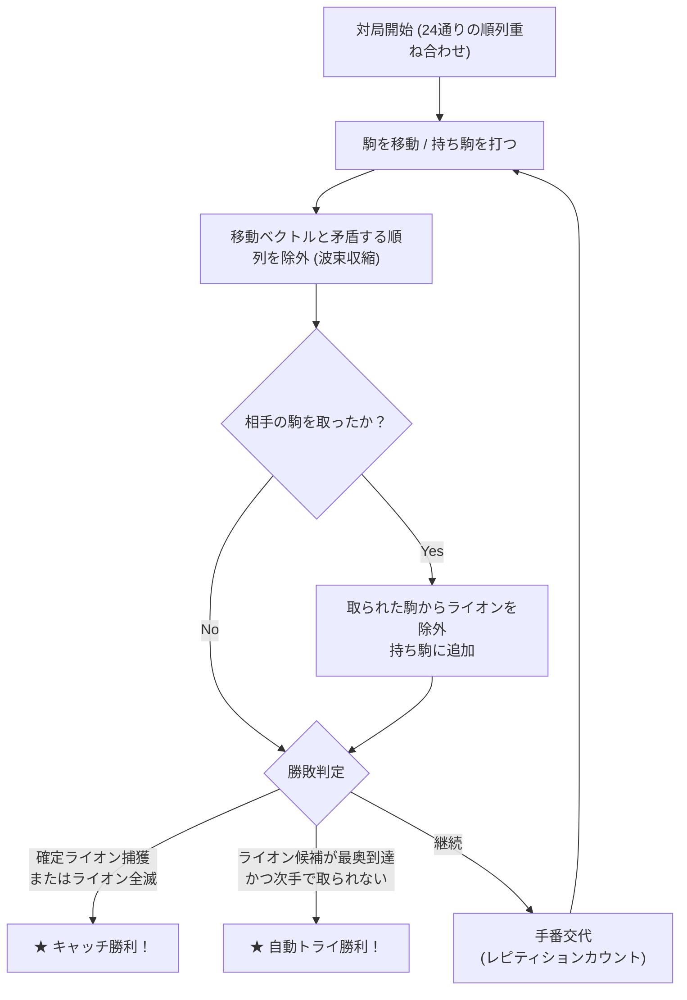

# 量子どうぶつしょうぎ（Quantum Doubutsu Shogi）システム仕様書

## 1. プロジェクト概要

本プロジェクトは、通常のどうぶつしょうぎ（`d0_six`：公式トライルールおよび幾何減衰レピティション・ペナルティ $\gamma^k$ 搭載）の強化学習成功を踏まえ、量子力学の「重ね合わせ（Superposition）」と「もつれ（Entanglement）」の概念を取り入れた**「量子どうぶつしょうぎ」**を制作・強化学習するためのシステムです。

サイコロ等の乱数測定（コラプス抽選）を行わず、**「消去法に基づく決定論的・公理的な制約充足（Belief State MDP）」**としてモデル化することで、リアル盤面でも成立する整合性の高いルールと、これまでの学習資産（MLP / 自己対局パイプライン）を100%継承した強化学習を実現しています。

---

## 2. 通常のどうぶつしょうぎ (`d0_six`) との対比・変更点一覧

| 項目 | 通常のどうぶつしょうぎ (`d0_six`) | 量子どうぶつしょうぎ |
| :--- | :--- | :--- |
| **盤面マスの状態** | 1つの確定した駒（One-hot: 0 or 1） | 各駒種である**確率ベクトル**（Belief: 0.0〜1.0の実数） |
| **駒の確定（収縮）** | 常に確定（静的） | 移動方向と矛盾する駒を消去法で除外（動的収縮） |
| **量子的もつれ** | なし（各駒は独立） | ある駒が確定すると他駒からその可能性が自動消滅 |
| **ライオン判定** | `find_lion` で盤上1箇所を一意に特定 | ライオンの確率 $P(\text{Lion}) > 0$ を持つ駒を追跡 |
| **相手駒の捕獲** | 確定した駒を持ち駒に加える | **取られた駒はライオン否定**。不確定性のまま持ち駒へ |
| **敵陣最奥への打ち** | ひよこを打つのは反則 | **打てる**。打った瞬間にひよこ否定（キリン・ゾウ化） |
| **トライ勝利条件** | ライオンが最奥に到達し次手で取られない | **ライオン候補駒が最奥に到達し次手で取られない（自動トライ）** |
| **成りの扱い** | ひよこが最奥到達でニワトリへ | 最奥到達でひよこがニワトリ候補へ昇格（ライオン否定駒は継続） |
| **自殺手** | ルール上合法（AIが探索で回避） | **すべて合法**（相手が確定ライオンを取れば即決着） |
| **千日手判定キー** | 盤面・持ち駒・手番のタプル | 盤面・持ち駒・**両者の生き残り順列タプル**・手番 |
| **NN入力次元** | $4 \times 3 \times 11 + 6 + 1 = 139$ 次元 | **同サイズの139次元（確率・期待値テンソル）** |
| **モデル構造・損失** | MLP (512 $\to$ 256 $\to$ 1), MSE / tanh | **同一構成をそのまま継承** |

---

## 3. ゲームルール詳細仕様

### 3.1 初期状態（重ね合わせ）
* 盤面サイズは $3 \times 4$（3列4行）。
* 各プレイヤーは初期駒4枚（ライオン $l$, きりん $g$, ぞう $e$, ひよこ $c$）を初期配置の4マスに配置。
* 開始時、4マスの正体は未確定であり、$4! = 24$ 通りの順列すべてが等確率（各25%）で重ね合わさった状態からスタートします。

### 3.2 移動による波束の収縮（観測）
* 駒を動かす際、現在その駒が取りうる候補駒種のいずれかが可能な移動ベクトル $\vec{v}$ であれば合法手となります。
* 移動が行われた瞬間、その移動ベクトル $\vec{v}$ を取ることができない駒種を含む順列が生き残りリスト（`valid_perms`）から即座に除外されます。

### 3.3 量子的もつれ（Entanglement）の自動連動
* 各プレイヤーの駒の正体は、個別のフラグではなく「全体の生き残り順列リスト」を参照して決定されます。
* 例：2手のアクション（斜め移動の後に縦移動など）によってある駒がライオンと確定した場合、生き残り順列から他駒がライオンになるパターンがすべて消滅するため、**動かしていない他の駒からも自動的にライオンの可能性が 0% に連動消滅**します。

### 3.4 捕獲と持ち駒
* 相手の駒を取った場合、**「取られた駒はライオンではない」**ことが確定します。
* 取られた駒は、ライオン以外の候補（きりん、ぞう、ひよこ等）の不確定性を保持したまま自分の持ち駒になります。
* 相手の盤上・持ち駒に残っている駒の中でライオンの可能性が絞り込まれます。

### 3.5 敵陣最奥への打ち（案A）
* 持ち駒を敵陣最奥列（先手なら1段目、後手なら4段目）に打つことができます。
* 最奥列に打った瞬間、行き所のない「ひよこ」の可能性がルール上消滅し、その駒は**キリンまたはゾウのどちらかに化けて確定・絞り込み**が行われます。

### 3.6 勝利条件
1. **キャッチ勝利**:
   * 相手の「ライオンに確定した駒」を取った場合、即座に勝利。
   * または相手の全駒からライオンの可能性が全滅（0%）した場合、即座に勝利。
2. **自動トライ勝利（膠着チキンレース解消仕様）**:
   * **ライオンの可能性を持つ駒（$P(\text{Lion}) > 0$）が敵陣最奥列に到達し、次の相手手番で取られなかった場合、その瞬間にトライ成立で勝利**。
   * ※「確定トライ」にした場合に発生する「相手の最奥駒をライオンに確定させないため、互いに駒を取れなくなる致命的な膠着」を完全に排除しています。
3. **ひよこの成り（ニワトリ）**:
   * すでにライオンの可能性が消滅している駒（例: 候補がひよこやゾウ）が最奥列に入った場合は、トライ判定の対象外となり、ひよこ候補が**ニワトリ候補に自動昇格してゲームを継続**します。



---

## 4. ニューラルネットワークと強化学習の仕様

### 4.1 入力ベクトル表現（139次元）
入力ベクトル $\mathbf{x} \in \mathbb{R}^{139}$ は、通常のどうぶつしょうぎと完全に同一の次元数を保ちながら、中身が**連続値（確率分布・期待値）**に拡張されています。

1. **盤面テンソル（132次元）**:
   * $4 \text{行} \times 3 \text{列} \times 11 \text{状態} = 132$
   * 11状態: `[空, 先手(l, g, e, c, h), 後手(l, g, e, c, h)]`
   * 空マスは空スロットに `1.0`。駒があるマスは、各駒種の確率 $P(k)$ が対応スロットに入り、そのマスの合計は常に `1.0`。
2. **持ち駒ベクトル（6次元）**:
   * `[先手g, 先手e, 先手c, 後手g, 後手e, 後手c]` の各駒種の**期待枚数**（実数値）。
3. **手番フラグ（1次元）**:
   * 後手番なら `1.0`、先手番なら `0.0`。

### 4.2 ネットワーク構造
* **構成**: 全結合型ニューラルネットワーク（MLP）
  * `Input(139)` $\to$ `Dense(512, ReLU)` $\to$ `Dense(256, ReLU)` $\to$ `Dense(1, tanh)`
* **総パラメータ数**: 203,265 個（重み行列 $W$ およびバイアス $b$）
* **出力**: 局面評価値 $V(\mathbf{x}) \in [-1.0, +1.0]$（常に先手 PLAYER_1 目線）

### 4.3 評価値の算出と手選択（Action Selection）
1. **視点調整**:
   $$V_{\text{eval}} = \begin{cases} V(\mathbf{x}_{\text{next}}) & (\text{先手手番}) \\ -V(\mathbf{x}_{\text{next}}) & (\text{後手手番}) \end{cases}$$
2. **即勝ち手の優先**:
   1手進めて即座にキャッチまたはトライが成立する手があれば、最優先で選択（評価値 $+1.0$）。
3. **レピティション・ペナルティ（幾何減衰）**:
   千日手を防止するため、過去に $k$ 回訪問した局面（盤面・持ち駒・順列タプルが一致）へ遷移する手に対して減衰を適用：
   $$V_{\text{penalized}} = -1.0 + (V_0 + 1.0) \times (\gamma^k) \quad (\gamma = 0.6)$$
4. **ソフトマックス確率化**:
   $$P(\text{手 } i) = \frac{\exp(\beta \cdot V_i)}{\sum_{j} \exp(\beta \cdot V_j)} \quad (\beta = 10.0)$$

### 4.4 自己対局と学習サイクル
1. **データ収集**:
   * モデル同士の自己対局を行い、各手番の盤面 $\mathbf{x}_t$（139次元）を蓄積。
   * 終局時の最終勝敗（先手勝ち: $+1.0$, 後手勝ち: $-1.0$, 引き分け: $0.0$）を全通過局面に正解ラベル $y$ として付与。
2. **重み更新（バックプロパゲーション）**:
   * 損失関数に平均二乗誤差（MSE）を採用：
     $$\mathcal{L}(W) = \frac{1}{B} \sum_{i=1}^{B} \left( V(\mathbf{x}_i) - y_i \right)^2$$
   * Adam オプティマイザにより、MSE を最小化するように 203,265 個の重み $W$ を更新。
3. **世代交代**:
   * 更新された重みを新世代モデル（`quantum_model_gen{N+1}.keras`）として保存し、次の自己対局へ投入。

---

## 5. ソースコード・ファイル構成

すべてのコードは、既存ファイルと完全に分離された独立フォルダ [`quantum_animal_shogi/`](file:///c:/Users/youyo/OneDrive/ドキュメント/渡辺研/quantum_project/quantum_animal_shogi) に配置されています。

```
quantum_animal_shogi/
├── constants.py          # 定数（順列定義24種、移動ベクトル逆引きマップ）
├── board.py              # QuantumBoard（順列追跡、139次元状態テンソル化、ハッシュ）
├── engine.py             # GameEngine（合法手生成、自動トライ判定、キャッチ、案A最奥打ち）
├── player.py             # ModelPlayer（深さ0/2探索、レピティションペナルティ、ソフトマックス）
├── train.py              # モデル学習・初期モデル作成（--init, MSE/tanh, numpy分割）
├── battle.py             # 対戦・自己対局スクリプト（train_data.npy 収集）
├── run_loop.py           # 世代交代自動ループ（自己対局 → 学習 → 新旧対戦評価）
└── test_quantum.py       # ルール検証用単体テスト
```

### 主要実行コマンド

```bash
# 1. ルールエンジンの単体テスト
python test_quantum.py

# 2. 初期モデル (Gen0) の生成
python train.py --init --output quantum_model_gen0.keras

# 3. 自己対局による棋譜データ収集 (100局)
python battle.py --m1 quantum_model_gen0.keras --m2 quantum_model_gen0.keras --games 100 --save_data train_data.npy

# 4. モデルの学習 (Gen1 の作成)
python train.py --data train_data.npy --output quantum_model_gen1.keras --epochs 10

# 5. 世代交代自動ループ (Gen0から3世代分を全自動実行)
python run_loop.py --start_gen 0 --num_gens 3 --games_per_gen 200 --epochs 10
```
